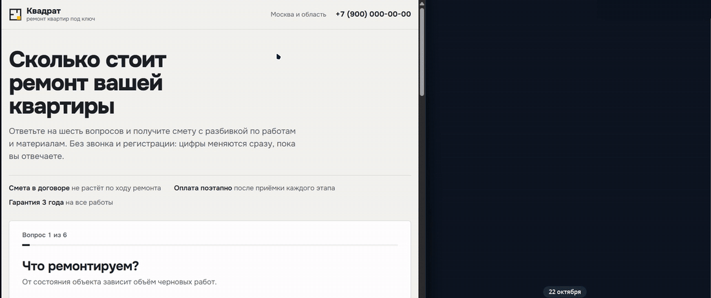

<div align="center">

# 🧮 Квиз-калькулятор стоимости ремонта

**Одностраничный сайт: посетитель отвечает на 6 вопросов, видит смету с разбивкой и оставляет заявку, которая сразу приходит менеджеру в Telegram со всеми параметрами и UTM-метками**

Для ремонтных бригад, студий интерьера и маркетологов, которые ведут на квиз трафик из Директа и таргета

### [🔗 Открыть сайт](https://renovation-calculator-gamma.vercel.app)

<br>


</div>

---

## 🎬 Как это выглядит

<p align="center"><b>Ответы на вопросы → смета собирается справа в реальном времени → заявка в Telegram</b></p>
<p align="center"></p>

---

## 💼 Какие задачи решает

| 😩 Было | ✅ Стало |
|---|---|
| Форма «Оставьте телефон» на лендинге, конверсия 1–2% | Квиз сначала даёт пользу (цену), телефон просит в конце, когда человек уже вовлечён |
| Калькулятор на Tilda не тянет формулы с коэффициентами и зависимыми опциями | Любая логика расчёта на JavaScript, цены в одном конфиге |
| Менеджер перезванивает и заново спрашивает площадь, тип ремонта, сроки | В заявке уже есть все ответы, смета по статьям и вилка цены |
| Непонятно, какая кампания приносит заявки | UTM-метки, yclid/gclid, реферер и устройство в каждом сообщении |
| Все заявки одинаковые, горячие теряются среди «просто посчитать» | Хэштег `#горячий`, если клиент готов начать в ближайший месяц |
| Спам от ботов в заявках | Ловушка-поле, проверка времени заполнения и лимит по IP |

---

## ✨ Возможности

<table>
<tr>
<td valign="top" width="50%">

### 🧭 Квиз

- 6 шагов: объект → площадь → тип ремонта → материалы → доп. работы → сроки
- Ползунок площади в виде **строительной рулетки** + ручной ввод
- Клик по карточке сразу ведёт дальше, с клавиатуры всё тоже проходится
- Ответы сохраняются: закрыл вкладку, вернулся, продолжил с того же шага
- Прогресс-бар, кнопка «Назад», проверка обязательных ответов

</td>
<td valign="top" width="50%">

### 📄 Смета

- Лист сметы справа **заполняется по мере ответов**: строки появляются, итог пересчитывается с анимацией
- Вилка цены, срок в неделях, цена за м²
- Каждая доп. работа отдельной строкой со стоимостью под вашу площадь
- Кнопка **PDF**: смета печатается отдельным аккуратным листом
- На телефоне итог закреплён внизу экрана

</td>
</tr>
<tr>
<td valign="top">

### 📨 Заявка в Telegram

- Имя, телефон, удобный способ связи, комментарий
- Маска телефона, «8» в начале понимается правильно
- Ссылка «Написать в WhatsApp / Telegram» прямо в сообщении
- Можно слать сразу в несколько чатов (владелец + группа менеджеров)
- Номер заявки совпадает с номером на PDF-смете клиента

</td>
<td valign="top">

### 🔒 Надёжность

- Токен бота только на сервере, в браузер не попадает
- **Сервер пересчитывает смету сам**: подделать цену в заявке через DevTools нельзя
- Экранирование пользовательского ввода в HTML Telegram
- Антиспам: honeypot, минимальное время заполнения, 5 заявок / 10 мин с IP
- Демо-режим без токена: заявка печатается в консоль

</td>
</tr>
</table>

---

## 📨 Что приходит менеджеру

```
Заявка № 3720 · калькулятор ремонта
#заявка #горячий

👤 Илья
📞 +7 (916) 123-45-67 · WhatsApp
💬 Написать в WhatsApp
📝 Нужна перепланировка кухни

🏠 Новостройка без отделки, 84 м², 3 комнаты, 1 санузел
🛠 Ремонт: Капитальный
🧱 Материалы: Стандарт
➕ Доп. работы: Демонтаж старой отделки, Вывоз мусора
🗓 Старт: В ближайший месяц

💰 1 860 000 ₽ – 2 310 000 ₽
   работы 1 014 000 ₽, санузлы 140 000 ₽, материалы 808 000 ₽, доп. 101 000 ₽
⏱ Срок ≈ 12 недель · 24 600 ₽ за м²

📊 Источник (сворачивается)
utm_source: yandex
utm_medium: cpc
utm_campaign: remont_msk
заполнил за 48 с
устройство: телефон
```

---

## 🧮 Как считается смета

```
работы     = площадь × расценка типа ремонта × коэффициент объекта
санузлы    = число санузлов × цена санузла для типа ремонта
материалы  = (работы + санузлы) × доля класса материалов
доп.работы = Σ цена опции × (м² | санузлы | комнаты | 1)
итого      = вилка от −10% до +12%
```

Все цифры лежат в [`public/js/config.js`](public/js/config.js). Поменять прайс, добавить опцию или тип ремонта = поправить массив, формулы трогать не нужно. Тот же файл читает сервер, поэтому сайт и Telegram всегда считают одинаково.

> Под другую нишу (клининг, сборка ПК, натяжные потолки, окна) меняется конфиг, тексты шагов в `app.js` и формула в `calc.js`. Каркас квиза, смета, отправка и антиспам остаются.

---

## 🚀 Запуск

### Локально

```bash
git clone <repo> && cd renovation-calculator
cp .env.example .env      # токен можно не указывать: будет демо-режим
npm run dev               # http://localhost:3000
npm test                  # 18 тестов
```

Зависимостей нет, `npm install` не нужен. Нужен Node.js 22+.

### Telegram-бот

1. Создать бота у [@BotFather](https://t.me/BotFather) → получить токен
2. Написать боту `/start` (или добавить его в группу менеджеров)
3. Узнать chat id: открыть `https://api.telegram.org/bot<ТОКЕН>/getUpdates` и найти `"chat":{"id":...}`
4. Вписать в `.env`:

```env
TELEGRAM_BOT_TOKEN=123456:ABC...
TELEGRAM_CHAT_ID=123456789,-1001234567890
```

### Деплой на Vercel (бесплатно)

1. Залить репозиторий на GitHub → **Import Project** в Vercel
2. В **Settings → Environment Variables** добавить `TELEGRAM_BOT_TOKEN` и `TELEGRAM_CHAT_ID`
3. Deploy. Статика раздаётся из `public/`, заявки принимает функция `api/lead.js`

Свой домен подключается в Vercel в пару кликов.

### Аналитика

Квиз отправляет события в `dataLayer` (для Google Tag Manager) и, если в `config.js` указан `metrikaId`, цели в Яндекс Метрику:

| Цель | Когда |
|---|---|
| `quiz_start` | первый ответ |
| `quiz_step_2` … `quiz_step_6` | переход на шаг (по ним строится воронка) |
| `quiz_result` | показана смета |
| `lead_sent` | заявка отправлена |

---

## 🗂 Структура

```
public/
  index.html        страница
  css/style.css     стили, адаптив, печать сметы
  js/config.js      цены, шаги, контакты компании
  js/calc.js        расчёт и форматирование (общий для браузера и сервера)
  js/app.js         квиз, смета, форма, аналитика
api/lead.js         serverless-функция Vercel: POST /api/lead
lib/lead.js         проверка заявки, текст сообщения, отправка, антиспам
server.js           локальный сервер для разработки
tests/              node:test, 18 тестов
```

---

## ⚠️ Перед запуском у заказчика

- Заменить цены в `config.js` на реальные расценки бригады
- Указать название, телефон, город в `BRAND`
- Поставить ссылку на политику обработки персональных данных (152-ФЗ) в форме
- Убрать или заменить блок фактов в шапке («Гарантия 3 года» и т.д.) на реальные условия компании
